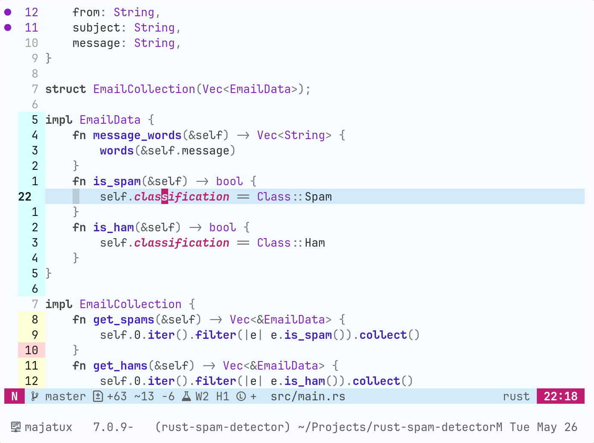

# litmus.nvim

A light colorscheme with rose accents and blue-washed surfaces.



## Install

```lua
-- lazy.nvim
{
  "majamin/litmus.nvim",
  dependencies = { "tjdevries/colorbuddy.nvim" },
  config = function()
    vim.cmd("colorscheme litmus")
  end,
}
```

## Customization

```lua
require("litmus").colors()
```

Override before setup:

```lua
local litmus = require("litmus.nvim")
litmus.palette.primary = "#0369a1"
litmus.setup()
```

See `lua/litmus/init.lua` for the full list of colors.

## License

[MIT](LICENSE)
